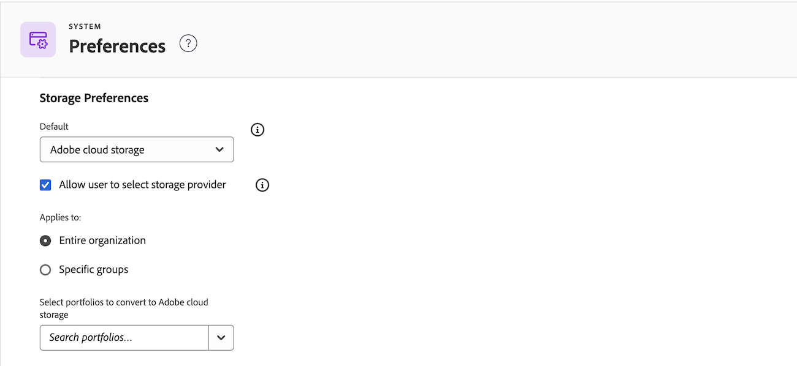

# Enable Adobe cloud storage for your organization

Adobe cloud storage is a unified, cloud-based storage solution that serves as the central repository for assets across Adobe enterprise products. This article describes how to enable Adobe cloud storage as the default storage option for your entire organization or for specific groups. 

This is the single action that turns on the new experience: once you enable it, new projects use Adobe cloud storage, which includes the Frame.io viewer and Unified Approvals. Nothing changes until you choose to enable Adobe cloud storage.

Because you control the timing, you can test the experience, update your Workfront Fusion scenarios, and plan for reporting changes before anyone works in it. For more information about what's different and how to plan your rollout, see [Move to Workfront on Adobe cloud storage](/help/quicksilver/review-and-approve-work/workfront-storage.md).

## How approvals work with Adobe cloud storage

Adobe cloud storage determines which approval service a project uses. Moving to a version of Workfront that supports Adobe cloud storage doesn't automatically switch your whole organization to Unified Approvals. Instead, the approval service depends on each project's storage model:

* **Adobe cloud storage projects** use Unified Approvals by default, with review and approval in the Frame.io viewer.
* **Legacy Workfront storage projects** keep the approval service they already use. Depending on your organization, this could be Unified Approvals or legacy document approvals.

For more information about the review and approval experience on Adobe cloud storage, see [Move to Workfront on Adobe cloud storage](/help/quicksilver/review-and-approve-work/workfront-storage.md).

## Access requirements

+++ Expand to view access requirements for the functionality in this article.

<table style="table-layout:auto"> 
 <col> 
 <col> 
 <tbody> 
  <tr> 
   <td role="rowheader">Adobe Workfront package</td> 
   <td>
Any Workflow package
</td> 
  </tr> 
  <tr> 
   <td role="rowheader">Adobe Workfront license</td> 
   <td>
Standard
 
Plan
</td> 
  </tr> 
  <tr> 
   <td role="rowheader">Access level configurations</td> 
   <td>You must be a Workfront administrator. </td> 
  </tr> 
 </tbody> 
</table>

For information, see [Access requirements in Workfront documentation](/help/quicksilver/administration-and-setup/add-users/access-levels-and-object-permissions/access-level-requirements-in-documentation.md). 

+++

## Enable Adobe cloud storage for your organization

To enable Adobe cloud storage for your organization:

{{step-1-to-setup}}

1. Select **System** in the left navigation, then select **Preferences**.
1. Scroll down to the **Storage preferences** section.
1. In the Default drop-down menu, select **Adobe cloud storage**.
1. (Optional) If you want to use a combination of Adobe cloud storage and Legacy Workfront Storage, select the **Allow user to select storage provider** checkbox.

    >[!NOTE]
    >
    >Enabling this option allows users to select the storage provider when they create a new project. Adobe cloud storage is labeled as "New project" since it is the default storage provider. Legacy Workfront Storage is labeled as "Legacy project".
    >
    >

1. In the Applies to drop-down menu, choose one of the following options:

    * **Entire organization**: This option applies the default storage provider to your entire Workfront environment. Any time a user creates a new project, the default storage provider will be used.
    * **Specific groups**: This option applies the default storage provider only to specific groups within your organization. Any time a user in the specified groups creates a new project, the default storage provider will be used.

        

1. Click **Save**.

    >[!NOTE]
    >
    >Existing projects keep the storage model they were created with. For example, projects that use Adobe cloud storage continue to use Adobe cloud storage after you change the default storage preference.

## Adobe cloud storage in sandbox environments

Adobe cloud storage is available in [!DNL Workfront] sandbox environments, allowing you to test the functionality described in this article before rolling it out in production. However, the Frame.io viewer is not available in sandbox, so the full unified review and approval experience must be validated in production.

If you have a Custom Refresh Sandbox, you must refresh it after upgrading to a version of Workfront that supports Adobe cloud storage. The refresh gives the sandbox access to the Adobe cloud storage functionality so you can begin testing it. For more information, see [The [!DNL Adobe Workfront] Custom Refresh Sandbox environment](/help/quicksilver/administration-and-setup/set-up-workfront/workfront-testing-environments/wf-custom-refresh-sandbox-environment.md).
