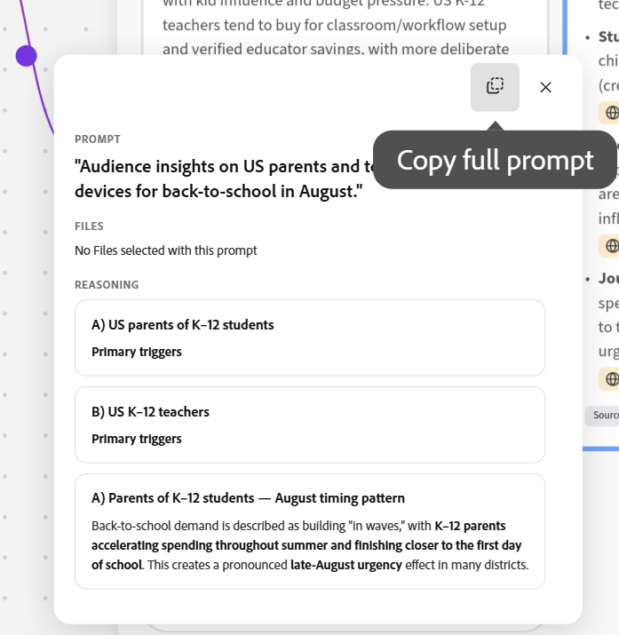

# Create briefs in the Ideation space

<!--add to TOC and miniTOC-->

The information on this page refers to functionality not yet generally available. It is available only as part of the **Ideation space Beta** program.    

For more information, see [Get started with Ideation space for Adobe Workfront Planning](/help/quicksilver/planning/ideation/get-started-with-planning-ideation.md).

>[!IMPORTANT]
>
>The information in this article refers to functionality available only for Workfront customers who also have Adobe Workfront Planning. Your company must purchase an additional Planning package.
>
>The functionality described here is not available if your organization purchased Workfront Planning as a standalone product. 
>
>For general information about Workfront Planning, see [Get started with Adobe Workfront Planning](/help/quicksilver/planning/general/planning-overview.md).
> 
>

<!--
Future - when they make it available in Planning: replace the above with this OR ... insert the snippet:

>[!IMPORTANT]
>
>The information in this article refers to Adobe Workfront Planning which your organization can purchase either as an Adobe Workfront package or a standalone product. 
>
>Not all capabilities included in the Planning package are available to Workfront Planning when it is purchased as a standalone product. 
>
>For general information about Workfront Planning, see [Get started with Adobe Workfront Planning](/help/quicksilver/planning/general/planning-overview.md).
> 
>For information about Workfront Planning as a standalone product, see [Get started with Adobe Workfront Planning as a standalone product](/help/quicksilver/planning/planning-sta/planning-sta-overview.md). 
>
-->

Using the Ideation Space, a new capability from Adobe Workfront Planning, you can turn briefs into Planning records or save it as an external file. Exported briefs create new records or update existing ones.

This article describes how you can brainstorm and strategize in the Ideation space to create briefs. 

You can do the following: 

* To create or update records, export finished Ideation briefs to Workfront Planning. 

* To use a brief's information in another application, export it to one of the following file types:

    * PDF
    * Word
    * PowerPoint
    * PowerPoint template

## Access requirements

+++ Expand to view the access requirements for the functionality in this article. 

<!--
are there additional license restrictions or packages to be purchased to have access to Ideation space?? If yes, update the table below
-->

<table style="table-layout:auto"> 
<col> 
</col> 
<col> 
</col> 
<tbody> 
    <tr> 
<tr> 
</tr> 
<tr> 
   <td role="rowheader">
Cloud provider requirements
</td> 
   <td>
Amazon Web Services (AWS)

   
<b>NOTE:</b>

   
We do not support any other cloud providers.

   </td> 
  </tr>
<tr> 
   <td role="rowheader">
Adobe Workfront package
</td> 
   <td> 
<ul> 
<li>
Any Workflow with a Planning package
</li>
<!--
Add this at GA - not available in beta:
Or
<li>
Any Planning package when purchased as a standalone product
</li>
-->
</ul>
   </td> 
<!--
<tr> 
<td role="rowheader">
Additional products
</td> 
<td><ul>
<li>
Adobe GenStudio for Performance Marketing
</li>
<li>
Adobe Customer Journey Analytics
</li>
</ul>
</td> 
</tr> 
-->
<tr> 
   <td role="rowheader">
System requirements
</td> 
   <td>
Coworker & MCP preferences settings in your System Preferences in the Setup area must be turned on

   </td> 
  </tr> 
  <tr> 
   <td role="rowheader">
Adobe Workflow license
</td> 
   <td>
Standard

   </td> 
  </tr> 
<tr> 
   <td role="rowheader">
Adobe Planning license
</td> 
   <td>
Standard

   </td> 
  </tr>  
<tr> 
   <td role="rowheader">
Access level configuration
</td> 
   <td> 
   <ul>
   <li>
You must add both a Workflow and a Planning license type to the access level <!--when you have both a Workflow and a Planning package-->
   </li>
   <li>
The Disable Ideation space setting in your access level must be deselected
</li>
   <li>
The Disable the CX Coworker panel in Workfront setting in your access level must be deselected
</li></ul>
</td> 
  </tr>  
   <tr> 
   <td role="rowheader">
Object permissions
</td> 
   <td> 
Contribute or higher permissions to the workspace and record type where you want to add records 

      
System Administrators have permissions to all workspaces, including the ones they did not create

      <!--
      not available right now:
      
View permissions to Workfront objects to add them to briefs 

      -->
      
Editor permissions on the Ideation space to create briefs

   </td> 
  </tr>  
    <!--
    <tr> 
    <td role="rowheader">
Adobe GenStudio for Performance Marketing user roles
</td> 
    <td>
<ul><li>Any GenStudio user role to access Campaigns, Products, and Personas</li>
    <li>GenStudio System Manager to access Activations and Events</li></ul>
    For information, see <a href="https://experienceleague.adobe.com/en/docs/genstudio-for-performance-marketing/user-guide/intro/user-roles">User roles and permissions</a>. 
    

    </td> 
    </tr> 
    -->
</tbody> 
</table> 

For more information about Workfront access requirements, see [Access requirements in Workfront documentation](/help/quicksilver/administration-and-setup/add-users/access-levels-and-object-permissions/access-level-requirements-in-documentation.md).

+++  

## Create Ideation space briefs

You can create briefs to either create or edit Planning records or to create files that you can export to other applications. 

1. Log in to Workfront with Planning where Coworker has been turned on, and do one of the following to open the Ideation space for the first time to create briefs: 

    * Go to the **Main Menu**  > **Ideation space**
    * Go to **Main Menu**  > **Planning** > click a workspace > click a record type > **New record** > **Start Ideation space**

1. Read the beta agreement and click **Agree**. You must sign the agreement to use Ideation space.  

     The Ideation space canvas opens and a new ideation is titled by default after the following format: 

     `catalyze-canvas-< number > - Month date, year at time` <!--submitted bug to change the default name to "Untitled ideation"-->
    
     For more information about creating records using Ideation space, see [Create Planning records from Ideation space briefs](/help/quicksilver/planning/ideation/create-records-in-ideation-space-for-planning.md). 

1. (Conditional) To open an existing brief in Ideation space, log in to Workfront with Planning where Coworker has been turned on, and do one the following: 

    * Go to **Main Menu**  > **Planning** > click a workspace > click a record type > click an existing record > **Open in Ideation space**
    
        The ideation name matches the name of the record. 

1. (Recommended) Click the name of the ideation to change the name, if you opened it for the first time. 
    
1. (Conditional and optional) To open another existing Ideation space, click the drop-down menu to the right of the ideation name, search for it by name, then click the ideation when it displays in the list. 
    
    The **Ideation space** opens and Coworker opens on the right. 
1. Use the Coworker prompt to describe the kind of brief you want to create. 

    For example, type "Create a back-to-school campaign for K-12 students to run through the month of August, for parents and teachers in the US".  To make the brief as complete as possible, indicate as much information as you have available for what kind of campaign, the timeline, the stakeholders, approvals checkpoints and other details. 
1. (Optional) Click the **+** icon in the Coworker prompt box and attach information in the following ways: 

    * **Commands**: Use a command from the list to prompt Coworker for content. 
    * **Attach file**: Attach a file to the prompt box to add it or its information to the ideation canvas. You must ask Coworker to create cards based on the file to later send the cards to the brief. 
    * **Reference an object**: Select an object from the list to reference it in your ideation. The object must exist in Workfront. 

1. Click Enter.  

1. Answer the questions from Coworker to continue the ideation, then click **Submit**

    Or

    Click **Skip questionnaire** to skip additional questions. 

1. (Conditional) When Coworker offers to the create cards for the ideation, answer **Yes**. 

    Cards are added to the ideation canvas and you can see the sources for each card and decide which to add to your brief. 

    >[!TIP]
    >
    >You cannot add files directly to the brief. You must first transfer the file information to the cards which you can send to the brief.

1. Click the **Search** icon  to search for items in the ideation canvas, then click when it displays in the list to navigate to it. 

1. (Optional) Click **Sources** at the bottom of every card to understand where the information was collected from. 

    Information can be imported either from Workfront Planning or the Web. 

    You can also click the **Sources** icon  in the upper-right corner of the space to display a list of sources for all the cards in the space. 
1. (Optional) Click **Comments**  in the upper-right corner of the space, and **@** tag others to start brainstorming inside the space.

    Users will receive an email notification about the tag.
1. (Optional) Click the **Filter** icon  inside the comment card to filter comments by the following criteria:

    * Reviewers
    * Time the comment was added
    * Status (where the comment was resolved or it is outstanding)
    * Unread (shows only unread comments)
1. (Optional) Use the **Thumbs up** or **Thumbs down** icons on a card  to give feedback on the accuracy of the information on the card. 
1. Click a card or click the frame containing all the cards, then click **Add to brief** to add their information to the brief. 

    Workfront matches each piece of information with the field it finds the most likely to store it. 

    For example, timelines are added to date-type fields, descriptions to paragraph-type fields. 

1. (Conditional) Click a card, then click **Ask AI to ...** to get ideas of the next step, before adding the information to the brief. The answers are in the context of each card's information. 
1. Click the **Add documents** icon  in the upper-left corner of the Ideation canvas to upload documents to the space. You can add new documents or documents you have already added to the space before. 

    >[!TIP]
    >
    >The Documents setting must be turned on to be able to access documents and upload them to the space.
    >For information, see the section [Configure the Ideation space canvas](#configure-the-ideation-space-canvas) in this article.
    > 
1. Click the **Add Workfront Connected Planning records** icon  and select a connected record type, then a record from each type to add that record's information to the record type you selected. 

    A card is created for the record you selected to add to the space. The record type displays in the upper-left corner of the record's card. 

    >[!TIP]
    >
    >* The **Add Workfront Connected Planning records** icon  is not available when you access the Ideation space from the Main menu and the brief is not connected to a Planning record.
    >
    >* Only connected planning records will be available to add to the Ideation space canvas as context for your ideation. Each connected record card added to the canvas will influence the type of content created and will use that context where applicable during your ideation.
    >
    >   For example, if you want to build a campaign that must leverage existing record types, then add those records to your canvas.

1. (Optional) Click the **More** menu  on the connected record card and click **View in Workfront**. 

    The record's details page opens in another browser tab in Workfront Planning. 
1. (Optional) Select the ideation frame or a card, click the **Delete** icon, then click **Delete** to confirm. The card is removed from the Ideation space canvas. 

    When you delete cards corresponding to a stored document or a record, the items are removed from the canvas but they remain in their respective applications. 

1. (Optional) Use the **Ask Coworker anything** box in the lower-right corner at any time to refine your ideation.

    For example, type `regenerate` for a specific card to have AI redo that card using updated context. The ideation space reruns its reasoning steps (searching, synthesizing, citing) and updates the affected cards.

1. (Optional) Click one of the purple connectors from any ideation card sets, then click the **Copy full prompt** icon to copy the prompt that generated the card to the clipboard, then paste it in the Coworker prompt box.  

    

1. (Optional) Click the **Undo** or **Redo** icons  at the top of the canvas to cancel or reverse an action. 
1. Zoom out to see the complete picture: your original campaign goal, all AI-generated concept cards with citations, additional documents, the real Workfront Planning records you've pulled in (Products, Personas, etc.). The **Brief** summary card in the lower-left corner pulls it all together.

1. Click the brief preview image in the lower-left corner and review the brief, then click one of the following options: 

    * **Export to file**. You can export the brief to the following file types:

        * PDF
        * Word
        * PowerPoint (with or without a template)
    * **Export to Workfront Planning**. The export overwrites all existing field data in the Planning record corresponding to the ideation.

    >[!TIP]
    >
    >**Export to Workfront Planning**  is dimmed when you access the Ideation space from the Main menu and the brief is not connected to a Planning record. 

    This finishes creating the record or the file with the additional information. If you started from an existing record, the information from the brief is added to the record. If you started with a new record, the record is created with the information in the brief. 

    For more information about updating Planning records using briefs, see the "ConsiderationsConsiderations about using the Ideation space to create records" section in the article [Create Planning records from Ideation space briefs](/help/quicksilver/planning/ideation/create-records-in-ideation-space-for-planning.md). 
1. (Optional) Click **Share** to share the ideation canvas with others.

    For more information, see [Share an Ideation space with others](/help/quicksilver/planning/ideation/share-the-ideation-space.md). 

## Configure the Ideation space canvas

There are controls for the Ideation space that configure what you see on the screen as well as help you navigate the canvas. 

1. Click the **Settings** icon  to control where AI pulls information from, then choose from the following **Source Types**:

    * **Documents** — documents uploaded to the selected space
    * **Web Search** — external web research
    <!--
     **CJA** — Adobe Customer Journey Analytics
    -->
1. Click **Save**. 

1. Click the the **zoom level** dropdown menu to the left of the **Help** icon  to select an option. 

    Choose from the following options:
    
    * **Zoom to fit**
    * **Zoom in**
    * **Zoom out**
    * Zoom to **50**, **100**, **150**, or **200%**
    * **Show dot grid**: Turn on selection to display dot grid. 
    * **Product tour**: Turn off selection to opt out of guiding hints while using Ideation space.

1. Click the **Help** icon  to review the keyboard shortcuts that you can use to navigate the canvas or select a different zoom value: 

| Action | Shortcut |
| --- | --- |
| Zoom in / out | Ctrl/⌘ + / − |
| Zoom to 100% / | Ctrl/⌘ 1 / 1 |
| Zoom to 200% / | Ctrl/⌘ 2 / 2 |
| Zoom to fit | Ctrl/⌘ 0 / 0 |
| Zoom to fit selection | Alt Ctrl 0 |
| Zoom to cursor | Ctrl/⌘ scroll |
| Pan | Hold Space drag |
| Show/hide dot grid | G |

<!--

    Once opened, the Ideation space agent goes through the following steps:

    1. **Data ingestion and synthesis**:  Pulls relevant information from connected sources. For example: 
    
        * Existing record types or the existing record type that you started from. 
        * Recent documents you might have uploaded in the ideation space. 
        * Web information that matches your prompt criteria.

            >[!TIP]
            >
            >The Web search setting must be turned on for AI to be able to look for information on the web.  
            >For information, see the section [Configure the Ideation space](#configure-the-ideation-space)in this article.
            >
    1. **Audience definition**: Identifies or recommends target audience parameters based on historical patterns
    1. **Strategy framing**: Structures the strategic narrative for the campaign
    1. **Messaging and concept ideation**: Generates initial message options and creative concept directions
    1. **Brief generation and planning handoff**: Produces a structured brief that feeds back into the Workfront Planning workspace

        When the Ideation agent finishes the process of collecting all the information, the following things occur: 
    
        * Five cards are created and are organized by relevant and like-information. 

            The cards are titled using various steps in the creation of the requested record, for easy recognition. 
    
            For example, they could be named:

            * Plan
            * Timeline
            * Segments
            * Mechanics  
            * Messaging 

        The cards titles are custom to each card in the ideation. 

        * The cards are placed inside the same frame indicating this is the result of one ideation. 

        * A brief is created and displays in a preview image in the lower-left corner of the Ideation space. <!
    
        The brief contains suggested fields that the system considers pertinent to the ideas you are exploring. 
-->

