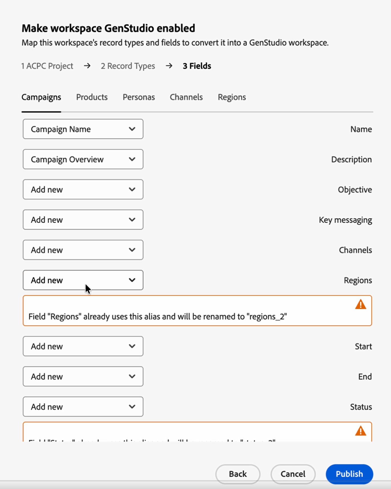

# Enable a Workfront Planning workspace to GenStudio for Performance Marketing

{{planning-important-intro}}

<!-- THIS IS HIDDEN FROM TOC-->

<!--Iskuhi said "ACPC projects" will be renamed when this will be released but not sure if it has been. Follow up with Syuzanna, Gurgen Mosesyan and possibly Himanshi Kumar - see slack threads -->

When your company also purchases Adobe GenStudio for Performance Marketing and you are an Adobe Workfront Planning customer, the GenStudio workspace is also available in  Workfront Planning. 

If you already have a Planning workspace in Workfront Planning, you can enable it for GenStudio for Performance Marketing instead of recreating the same data from it in GenStudio. 

Enabling a workspace links it to an Adobe Could Storage project and maps its record types and fields to GenStudio workspace. After you complete the configuration, you can open the workspace's records in GenStudio.

You must have the following: 

* Access to both Workfront Planning and GenStudio for Performance Marketing. 
* An Adobe Cloud Storage project to link to the workspace. An organization administrator can create one in the Adobe Admin Console. 
  
    For information, see [Manage Adobe storage](https://helpx.adobe.com/business/enterprise/manage-storage-assets/manage-storage/manage-adobe-storage.html). <!--ensure this site still works-->

## Access requirements

+++ Expand to view the access requirements for the functionality in this article. 

<table style="table-layout:auto"> 
<col> 
</col> 
<col> 
</col> 
<tbody> 
    <tr> 
<tr> 
</tr>   
<tr> 
   <td role="rowheader">
Adobe Workfront package
</td> 
   <td> 

Any Workfront or Workflow and any Planning package
 
Or

Any Planning package when purchased as a standalone product

   </td> 
   <tr> 
<td> 
   
 Additional products
 </td> 
   <td> 
   
 Adobe GenStudio for Performance Marketing
</td> 
  </tr>

<tr> 
<td> 
   
 Adobe Admin Console settings
 </td> 
   <td> 
   
 You must create Adobe Storage Cloud projects in the Adobe Admin Console 

   
   
For information, see <a href="https://helpx.adobe.com/business/enterprise/manage-storage-assets/manage-storage/projects-in-business-storage.html#project-policies">Manage projects</a>
   
   </td> 
  </tr>
  <tr> 

  <tr> 
   <td role="rowheader">
Adobe Workfront license
</td> 
   <td>
Workflow Standard

   </td> 
  </tr> 
  <tr> 
   <td role="rowheader">
Adobe Planning license
</td> 
   <td>
Planning Standard

   </td> 
  </tr>
<tr> 
   <td role="rowheader">
Adobe Workfront Access level configuration
</td> 
   <td> 
You must add both a Workflow and a Planning license type to the Workfront access level when you have both a Workflow and a Planning package
   
</td> 
  </tr> 

  <tr> 
   <td role="rowheader">
Adobe GenStudio for Performance Marketing user roles
</td> 
   <td>
<ul><li>Any GenStudio user role if you need to access Campaigns, Products, and Personas</li>
   <li>GenSudio System Manager if you need to access Activations <!--and Events--></li></ul>
   For information, see <a href="https://experienceleague.adobe.com/en/docs/genstudio-for-performance-marketing/user-guide/intro/user-roles">User roles and permissions</a>. 
   

  </td> 
  </tr>   
<tr> 
   <td role="rowheader">
Object permissions
</td> 
   <td>  
   
In Workfront Planning: 

   <ul>
   <li>
Manage permissions to the workspace <!--to add new fields or record types to the GenStudio workspace-->
</li>
   <!--
   <li>
Contribute permissions to the GenStudio workspace to add, update, or delete records in the GenStudio workspace
 </li>  
   -->
   </ul>
   <!--
   
No users can remove GenStudio for Performance Marketing record types or fields from the GenStudio workspace in Workfront Planning

   -->
   
In Adobe GenStudio for Performance Marketing: 

   <ul>
   <!--
   <li>
 Any permissions in Adobe GenStudio for Performance Marketing
</li>
   -->
   <li>
 Create permissions in Adobe GenStudio for Performance Marketing to create items
</li></ul>
   </td>  
</tbody> 
</table> 

For information about Adobe Workfront Planning access, see [Adobe Workfront Planning access overview](/help/quicksilver/planning/access/access-overview.md).

For more information about Adobe GenStudio for Performance Marketing, see [Adobe GenStudio for Performance Marketing User Guide](https://experienceleague.adobe.com/en/docs/genstudio-for-performance-marketing/user-guide/home).

+++ 

## Enable a Workfront Planning workspace to GenStudio 

1. In Workfront Planning, open the workspace you want to enable.
1. Click the **More** menu  to the right of the workspace name, then click **Enable GenStudio**.

    The **Make workspace GenStudio** enabled box opens with the following steps:
    
    1. **ACPC Project**:  Select the **ACPC Project** (Adobe Cloud Storage project) you want to sync with this workspace, then click **Next**. Users access the workspace in GenStudio through this project.

        

    1. **Record Types**: Map the workspace's record types to the six record types that GenStudio requires: 
    
        * Campaigns
        * Products
        * Personas
        * Channels
        * Regions
        * Activations
      
        For each one, open the list and select the matching Planning record type, or select **Add new** to create it, then click **Next**.

        
    
    1. **Fields**: Map the fields for each record type. Use the tabs at the top of the dialog to move between record types. For each field, select the matching Planning field, or select **Add new** to create a field.

        Repeat the field setup for all record types. 

        

    1. Review and address any warnings. 
    
        For example, a new field can become the primary field for the record type or a field alias that's already in use is renamed (if you already have a field named "Regions", the imported one might become "Regions 2"). 
      
        Mapping a **Status** field adds the required options.
 
    1. Click **Publish**. 
    
        A confirmation message appears when the workspace is enabled. Mapped record types are marked in the workspace. 

        The record types mapped to be accessible from GenStudio have a new **Adobe** icon on their cards. 

        
      
1. Open GenStudio, and select **Campaigns**, then click the **ACPC project** you originally configured for this setup in the lower-left corner of the screen. Review the imported record types and fields. 

    >[!TIP]
    >
    >You see only the records that your Adobe Cloud Storage project membership allows.
