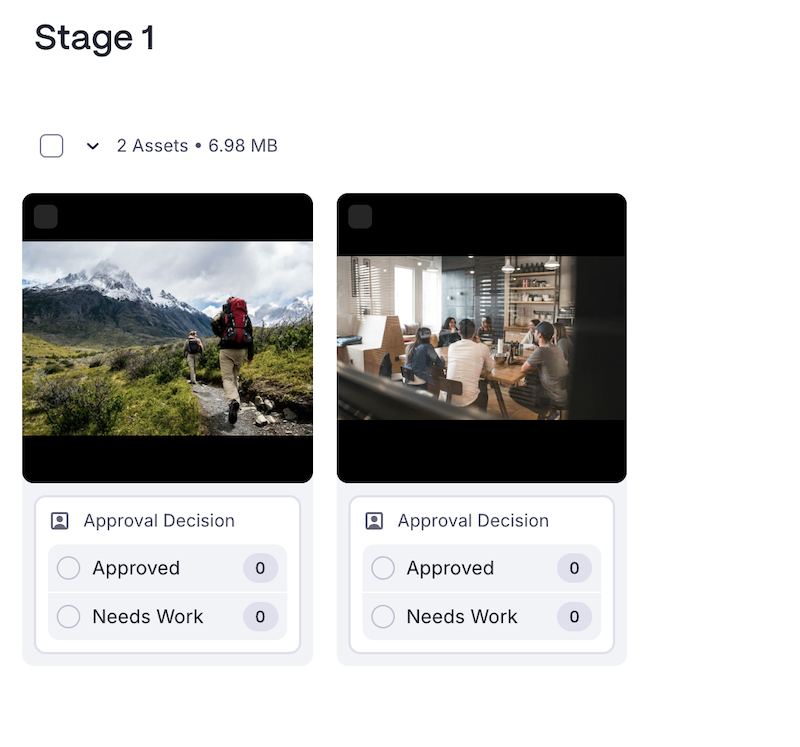

# Review a grouped approval

{{highlighted-preview-article-level}}

When you're assigned to a grouped approval, all the documents in the group appear together so you can make a decision on each one. You can approve or request changes on every document at once, or make a decision on each document individually.

If one or more documents are marked **Needs work** in a multi-stage grouped approval, the group cannot advance to the next stage until all the documents in the group have an approved decision. For more information, see [Resolve a "Needs work" decision on a single document in a multi-stage grouped approval](#resolve-a-needs-work-decision-on-a-single-document-in-a-multi-stage-grouped-approval).

>[!IMPORTANT]
>
>If your organization uses Adobe cloud storage, you will see the new Documents area when you access documents in Workfront. Grouped approvals are available only in the new Documents area. For more information about Adobe cloud storage, see [Adobe cloud storage overview](/help/quicksilver/review-and-approve-work/esm-overview.md).

## Access requirements

+++ Expand to view access requirements for the functionality in this article.

<table style="table-layout:auto">
 <col>
 <col>
 <tbody>
  <tr>
   <td role="rowheader">Adobe Workfront package</td>
   <td> 
Any Workflow package to manage approvals using Adobe cloud storage
 </td>
  </tr>
  <tr>
   <td role="rowheader">Adobe Workfront license</td>
   <td>
   
Contributor or higher

   
Review or higher

   </td>
  </tr>
  <tr>
   <td role="rowheader">Access level configurations</td>
   <td> 
View or higher access to the objects associated with approvals
</td>
  </tr>
  <tr>
   <td role="rowheader">Object permissions</td>
   <td> 
View or higher permissions to the objects associated with approvals
</td>
  </tr>
 </tbody>
</table>

For information, see [Access requirements in Workfront documentation](/help/quicksilver/administration-and-setup/add-users/access-levels-and-object-permissions/access-level-requirements-in-documentation.md).

+++

## Review a grouped approval from the My Approvals widget in Home

The My Approvals widget in Home groups the documents under a single approval so you can act on all of them together.

>[!NOTE]
>
>You may have to add the My Approvals widget to your Home page. For more information, see [Add, edit, or remove widgets in Home](/help/quicksilver/workfront-basics/using-home/using-the-home-area/add-edit-remove-widgets-in-new-home.md).

1. Click the **Home** icon in the upper-left corner of Adobe Workfront, then find the **My Approvals** widget.

1. Open the grouped approval. All the documents in the group are listed together, with the number of items in the group at the top.

1. Make a decision using one of the following:

   * **Mark all approved**: Records an approved decision on every document in the group at once.
   * **Mark all needs work**: Records a needs-work decision on every document in the group at once.
   * **Make decision**: Make an individual decision on a single document. Repeat for each document you want to decide on separately.

   

## Review a grouped approval in the Frame.io viewer

In the Frame.io viewer, all the documents in the group display together so you can make a quick decision on each one, or open a document to review it in detail.

1. Go to your review email notification and click **Go to review**, or open the grouped approval from the **My Approvals** widget in Home.

1. Do one of the following:

   * Make a quick decision on each document directly from the group page, without opening it.
   * Click a document to open it, add comments or markup, then use the arrow to move to the next document in the group. The document counter (for example, **1 of 2**) shows your place in the group.

   For more information on commenting and markup in the Frame.io viewer, see [Review and approve with the Frame.io viewer](/help/quicksilver/review-and-approve-work/document-reviews-and-approvals/review-with-frame.md).

1. Choose a decision for each document:

   * **Approved**: The document does not need changes and is ready for use.
   * **Needs Work**: The document needs changes and is not ready for use.

   For more information about decisions, see [Document decision status overview](/help/quicksilver/review-and-approve-work/document-reviews-and-approvals/manage-document-approvals/document-approval-status.md).

   

## Additional resources 

This article covers what's specific to reviewing a group of documents. For information on making a decision on a single document, adding markup, and more, see

* [Approve a document in Workfront](/help/quicksilver/review-and-approve-work/document-reviews-and-approvals/review-and-approve-documents/approve-a-document.md)
* [Review a document in Workfront](/help/quicksilver/review-and-approve-work/document-reviews-and-approvals/review-and-approve-documents/review-a-document.md)
* [Review and approve with the Frame.io viewer](/help/quicksilver/review-and-approve-work/document-reviews-and-approvals/review-with-frame.md)